<h1 align="center">Tema 1.2 · Entornos de desarrollo portables y ligeros</h1>

<p align="center">
  <strong>Dart y Flutter en Windows</strong><br>
  Aplicaciones Móviles · Unidad 1: Arquitectura, entorno ligero e interfaces móviles
</p>

| | |
|---|---|
| **Estudiante** | Ronny Antonio Villa Villa |
| **Asignatura** | Aplicaciones Móviles |
| **Tema** | 1.2 — Entornos de desarrollo portables y ligeros |
| **Flutter / Dart** | 3.47.1 (canal stable) / 3.13.1 · DevTools 2.60.0 |
| **Ruta del entorno** | `C:\dev` (SDK, VS Code portable, caché de paquetes y proyectos) |
| **Destinos usados** | Consola (Dart) y Chrome (Flutter web) |

## Contenido

1. [Objetivo](#1-objetivo)
2. [Diagnóstico de mi equipo](#2-diagnóstico-de-mi-equipo-actividad-1)
3. [Entorno de desarrollo](#3-entorno-de-desarrollo-actividad-2)
4. [Diagnóstico con `flutter doctor`](#4-diagnóstico-con-flutter-doctor-actividad-2)
5. [Kit portable](#5-kit-portable-actividad-3)
6. [Dart en consola](#6-dart-en-consola-actividad-4a)
7. [Flutter en Chrome con hot reload](#7-flutter-en-chrome-con-hot-reload-actividad-4b)
8. [Destinos de ejecución](#8-destinos-de-ejecución)
9. [Problemas resueltos](#9-problemas-resueltos-durante-la-práctica)
10. [Pruebas automáticas](#10-pruebas-automáticas)
11. [Evidencias](#11-evidencias)
12. [Estructura del repositorio](#12-estructura-del-repositorio)

## 1. Objetivo

Configurar un entorno de desarrollo Dart y Flutter portable y ligero en Windows, verificarlo con `flutter doctor`, ejecutar una aplicación de consola y una aplicación Flutter en Chrome con hot reload, y documentar el proceso.

## 2. Diagnóstico de mi equipo (Actividad 1)

| Recurso | Dónde verlo | Mi equipo |
|---|---|---|
| Memoria RAM | Rendimiento > Memoria | 16 GB DDR4 (15,7 GB utilizables) |
| Espacio libre en disco | Explorador > Este equipo | 8,73 GB libres de 161 GB (disco C:) |
| Procesador | Rendimiento > CPU | Intel Core i3-1215U, 12.ª generación, 3,07 GHz |
| Virtualización | Rendimiento > CPU > Virtualización | Habilitada |
| Permisos de administrador | ¿Puedo instalar programas? | Sí |

> **Decisión: entorno ligero (consola y Chrome).**
> El equipo tiene 16 GB de RAM, pero el uso de memoria ronda el 70 % durante el trabajo y el procesador es de bajo consumo (i3, serie U). Además, el disco C: tiene poco espacio libre (8,73 GB), y un emulador de Android necesita varios GB de imágenes del sistema y mucha memoria. Por eso uso la consola para Dart y Chrome para Flutter, que no requieren emulador ni instalaciones pesadas.

Evidencias: Figuras 1 a 3.

## 3. Entorno de desarrollo (Actividad 2)

| Componente | Ubicación o versión |
|---|---|
| SDK de Flutter | `C:\dev\flutter` |
| Visual Studio Code portable | `C:\dev\vscode` (con carpeta `data`) |
| Caché de paquetes (`PUB_CACHE`) | `C:\dev\pub-cache` |
| Carpeta de proyectos | `C:\dev\proyectos` |
| Flutter | 3.47.1, canal stable |
| Dart | 3.13.1 |
| DevTools | 2.60.0 |
| Extensiones de VS Code | Dart y Flutter |

Se agregó `C:\dev\flutter\bin` al PATH y se verificó con `where.exe flutter` y `flutter --version` en una terminal nueva (Figura 4). Las extensiones Dart y Flutter quedaron instaladas dentro del VS Code portable, en `C:\dev\vscode\data\extensions` (Figuras 6 y 7).

> **Nota:** el comando correcto es `flutter --version`, sin punto final; con el punto, este se interpreta como parte del argumento.

## 4. Diagnóstico con `flutter doctor` (Actividad 2)

La salida completa está en [`doctor.txt`](doctor.txt) (generada con `flutter doctor -v`).

| Componente | Estado | Detalle |
|---|---|---|
| Flutter | OK | 3.47.1 stable, Dart 3.13.1 |
| Windows | OK | Windows 11 reconocido |
| Android toolchain | `!` con X | Estado de licencias de Android desconocido (`flutter doctor --android-licenses`) |
| Chrome | OK | Disponible para Flutter web |
| Visual Studio | `!` con X | Faltan componentes de "Desarrollo para el escritorio con C++" (MSVC, CMake, Windows SDK) |
| Dispositivos | OK | Windows (desktop), Chrome (web), Edge (web) |
| Red | OK | Recursos disponibles |

**Reflexión: ¿qué necesito realmente?**
Las dos categorías con `!` son *Android toolchain* (X en las licencias) y *Visual Studio* (X en los componentes C++). Ninguna es necesaria para este curso: las licencias de Android y el SDK solo hacen falta para compilar en un celular o emulador, y los componentes C++ solo para compilar aplicaciones de escritorio de Windows. Para ejecutar Dart en consola y Flutter en Chrome bastan las categorías en verde (Flutter y Chrome).

## 5. Kit portable (Actividad 3)

El archivo [`iniciar.bat`](iniciar.bat) prepara el entorno en una ventana de comandos:

1. Define la base `DEV`: la carpeta donde está el script (`%~dp0`) si contiene `flutter\bin\flutter.bat`; si no, usa `C:\dev\`.
2. Antepone `flutter\bin` al `PATH` y define `PUB_CACHE` en `pub-cache`.
3. Comprueba con `where flutter`, muestra la versión con `call flutter --version` y verifica que exista `vscode\Code.exe`.
4. Abre VS Code portable con la carpeta del script (o con `proyectos` si el script está en `C:\dev`).

<details>
<summary>Ver el contenido de <code>iniciar.bat</code></summary>

```bat
@echo off
setlocal

REM %~dp0 = unidad y carpeta donde esta guardado este .bat (incluye la barra final)
REM Los "set" solo afectan a esta ventana; no se toca el PATH permanente de Windows.

set "DEV=%~dp0"
if not exist "%DEV%flutter\bin\flutter.bat" set "DEV=C:\dev\"

set "PATH=%DEV%flutter\bin;%PATH%"
set "PUB_CACHE=%DEV%pub-cache"

set "PROYECTO=%~dp0"
if /i "%~dp0"=="%DEV%" set "PROYECTO=%DEV%proyectos"

echo ==========================================
echo   ENTORNO PORTABLE DART Y FLUTTER
echo ==========================================
echo.

echo [1/3] Verificando Flutter...
where flutter
if errorlevel 1 (
    echo ERROR: No se encontro Flutter.
    goto error
)

echo.
call flutter --version
if errorlevel 1 (
    echo ERROR: Flutter no pudo ejecutarse.
    goto error
)

echo.
echo [2/3] Verificando VS Code portable...
if not exist "%DEV%vscode\Code.exe" (
    echo ERROR: No se encontro "%DEV%vscode\Code.exe"
    goto error
)

echo VS Code encontrado.
echo.
echo [3/3] Abriendo VS Code portable...
start "" "%DEV%vscode\Code.exe" "%PROYECTO%"

echo.
echo Proceso de inicio completado.
pause
exit /b 0

:error
echo.
echo Se produjo un problema. Revisa los mensajes anteriores.
pause
exit /b 1
```

</details>

### ¿Qué hace `%~dp0`?

`%0` es la ruta con la que se invocó el script. Los modificadores `~d` (unidad) y `~p` (ruta) la reducen a unidad y carpeta, con barra final. Por ejemplo, si el script está en `C:\dev\iniciar.bat`, `%~dp0` vale `C:\dev\`. Así las rutas son relativas al propio script y el kit se puede mover a otra carpeta o a una memoria USB sin editar el archivo.

### ¿Por qué el cambio del PATH es temporal?

`set PATH=...` modifica una variable del proceso `cmd` que ejecuta el script (y de los procesos que este inicia, como VS Code). Además, `setlocal` limita los cambios a ese script. Al cerrar la ventana el proceso termina y la variable desaparece: no se escribe en el PATH permanente de Windows (el que se configura en "Variables de entorno").

### Prueba realizada

- **Sin el script:** con `flutter` fuera del PATH permanente (sin `C:\dev\flutter\bin` y sin la instalación previa de Descargas), una terminal normal **no reconoce** `flutter` ni `where.exe` lo encuentra (Figura 10).
- **Con `iniciar.bat`:** `where flutter` lista solo `C:\dev\flutter\bin`, `flutter --version` funciona y VS Code portable se abre (Figura 9), porque el script agrega `flutter\bin` al PATH solo para su proceso.

## 6. Dart en consola (Actividad 4A)

El proyecto `hola_entorno` (creado con `dart create -t console hola_entorno`) pide el nombre con `stdin.readLineSync()`, imprime un saludo y muestra el sistema operativo y la versión de Dart (Figura 11).

| Forma de ejecutar | Resultado |
|---|---|
| `dart run` en la terminal | Funciona: se puede escribir el nombre. |
| F5 **sin** `launch.json` | El programa corre en la *Debug Console*, que no admite entrada por teclado: el nombre escrito no llega al programa. |
| F5 **con** `launch.json` (`"console": "terminal"`) | El programa corre en la terminal integrada y sí permite escribir el nombre. |

Configuración en [`hola_entorno/.vscode/launch.json`](hola_entorno/.vscode/launch.json):

```json
{
  "version": "0.2.0",
  "configurations": [
    {
      "name": "Dart: Ejecutar en terminal integrada",
      "type": "dart",
      "request": "launch",
      "program": "${file}",
      "console": "terminal",
      "noDebug": true
    }
  ]
}
```

- `program: "${file}"`: ejecuta el archivo abierto en el editor.
- `console: "terminal"`: usa la terminal integrada, que sí tiene entrada estándar.
- `noDebug: true`: ejecuta sin iniciar el depurador.

**Diferencia entre ambos resultados:** sin configuración, VS Code usa la *Debug Console*, que solo muestra salida; con `"console": "terminal"` el programa se conecta a una terminal real y `stdin` recibe lo que se escribe.

**Ajuste en el kit portable:** para que F5 abra siempre la terminal desde el VS Code portable, se configuró `"dart.cliConsole": "terminal"` en los ajustes de usuario del propio VS Code portable (`C:\dev\vscode\data\user-data\User\settings.json`), de modo que la configuración viaja con el kit.

> Para que VS Code use el `launch.json`, la carpeta abierta debe ser `hola_entorno`, porque solo lee `.vscode/launch.json` en la raíz de la carpeta abierta. En algunos equipos F5 requiere `Fn + F5`.

## 7. Flutter en Chrome con hot reload (Actividad 4B)

1. `flutter create hola_flutter`.
2. `flutter devices` para listar los destinos disponibles (Figura 5).
3. `flutter run -d chrome` para ejecutar la aplicación (Figura 12).
4. En `lib/main.dart` se cambió el `title` de `MaterialApp` por `'Mi Proyecto Ronny Villa'` y se guardó.
5. Se cambió el `seedColor` del tema, se guardó y se presionó `r` en la terminal: la salida muestra `Reloaded application` y el color de la interfaz cambió sin reiniciar la aplicación (Figura 13).

## 8. Destinos de ejecución

| Destino | Estado |
|---|---|
| Consola (Dart) | Usado: `hola_entorno` |
| Chrome (web) | Usado: `hola_flutter` |
| Edge (web) | Detectado por `flutter devices` |
| Windows (desktop) | Detectado, pero no usable para compilar: faltan los componentes C++ de Visual Studio |
| Celular físico | No conectado |
| Emulador Android | No usado (el equipo se dimensionó para un entorno ligero) |

## 9. Problemas resueltos durante la práctica

### 9.1. Dos SDK de Flutter: el PATH apuntaba a la instalación de Descargas

- **Problema:** `flutter doctor` y `where.exe flutter` mostraban `C:\Users\ronni\Downloads\flutter` en lugar del SDK de `C:\dev\flutter` (Figura 8).
- **Causa:** el SDK descargado quedó en Descargas y su carpeta `bin` estaba en el PATH del sistema, mientras que `C:\dev\flutter\bin` no estaba.
- **Solución:** quitar `Downloads\flutter\bin` del PATH, agregar `C:\dev\flutter\bin` y abrir una terminal nueva.
- **Verificación:** `where.exe flutter` devolvió solo `C:\dev\flutter\bin` y `doctor.txt` se regeneró desde ese SDK (Figura 4).

### 9.2. Entrada por teclado en la ejecución con F5

- **Problema:** el programa Dart no permitía escribir el nombre al ejecutarlo con F5.
- **Causa:** la *Debug Console* no admite entrada estándar.
- **Solución:** `"console": "terminal"` en `launch.json` (y `dart.cliConsole` en el VS Code portable).
- **Verificación:** el programa pide el nombre en la terminal integrada y muestra el saludo.

### 9.3. `iniciar.bat` se detenía después de Flutter

- **Problema:** al llamar `flutter --version` el script terminaba sin ejecutar las líneas siguientes.
- **Causa:** `flutter` es un archivo `.bat`; sin `call`, el control no regresa al script.
- **Solución:** `call flutter --version`.
- **Verificación:** el script continuó, verificó VS Code y llegó a "Proceso de inicio completado".

Otros casos de configuración se documentan en [`clinica_errores.md`](clinica_errores.md).

## 10. Pruebas automáticas

- `hola_entorno`: `dart test` — la prueba de ejemplo pasó.
- `hola_flutter`: `flutter test` — la prueba de widget de ejemplo pasó.

## 11. Evidencias

Todas las capturas están en la carpeta [`evidencias/`](evidencias/), agrupadas por actividad.

### Actividad 1 — Diagnóstico de mi equipo

Administrador de tareas y Explorador de archivos: procesador Intel Core i3-1215U con **virtualización habilitada**, memoria de 16 GB y **8,73 GB libres** en el disco C:.

<p align="center">
  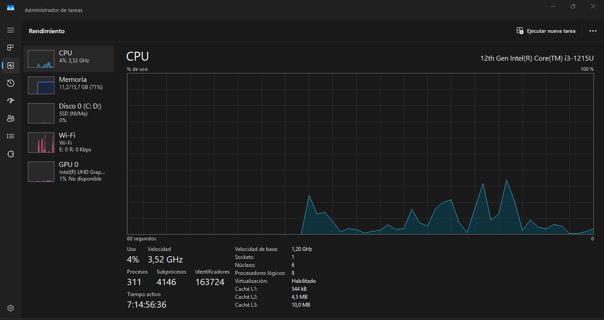<br>
  <em>Figura 1. Diagnóstico del equipo (1 de 3)</em>
</p>

<p align="center">
  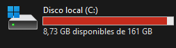<br>
  <em>Figura 2. Diagnóstico del equipo (2 de 3)</em>
</p>

<p align="center">
  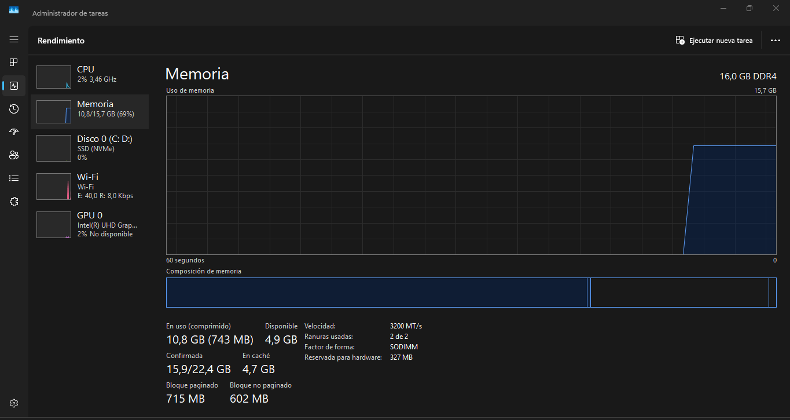<br>
  <em>Figura 3. Diagnóstico del equipo (3 de 3)</em>
</p>

### Actividad 2 — Instalación portable

<p align="center">
  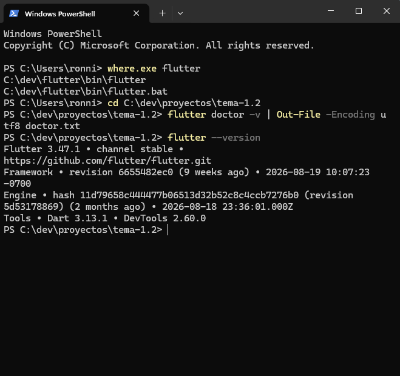<br>
  <em>Figura 4. <code>where.exe flutter</code> apunta a <code>C:\dev\flutter\bin</code>; se genera <code>doctor.txt</code> y se muestra <code>flutter --version</code></em>
</p>

<p align="center">
  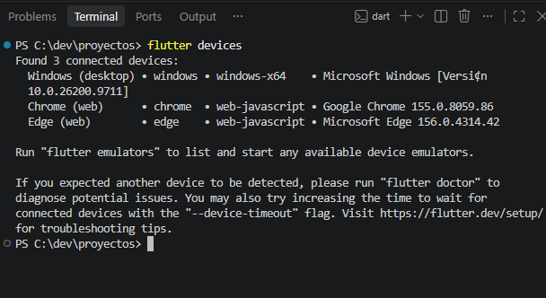<br>
  <em>Figura 5. <code>flutter devices</code>: Windows, Chrome y Edge</em>
</p>

<p align="center">
  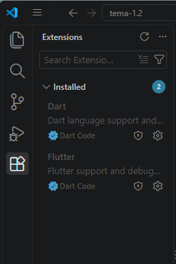<br>
  <em>Figura 6. Extensiones Dart y Flutter instaladas en VS Code</em>
</p>

<p align="center">
  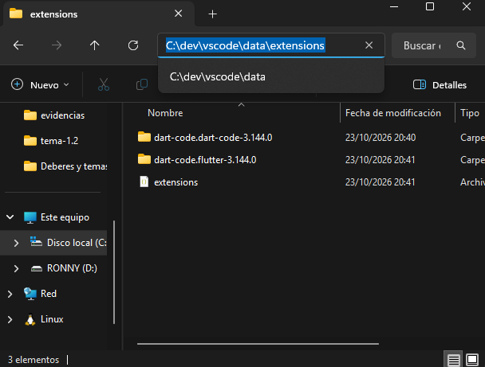<br>
  <em>Figura 7. Carpeta <code>C:\dev\vscode\data\extensions</code> del VS Code portable</em>
</p>

### Actividad 3 — Mi kit portable

<p align="center">
  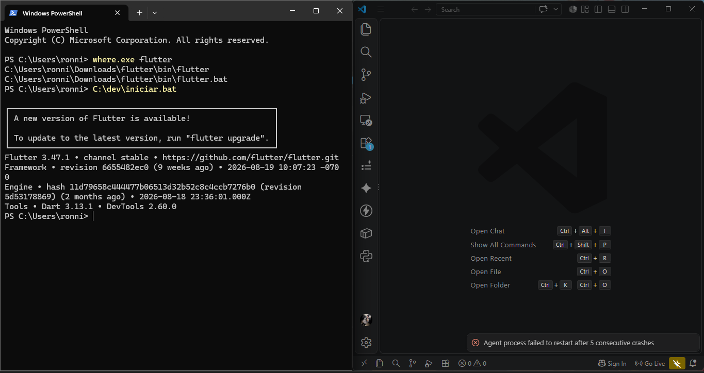<br>
  <em>Figura 8. Estado inicial: <code>where.exe flutter</code> apuntaba a Descargas, y primera ejecución de <code>iniciar.bat</code></em>
</p>

<p align="center">
  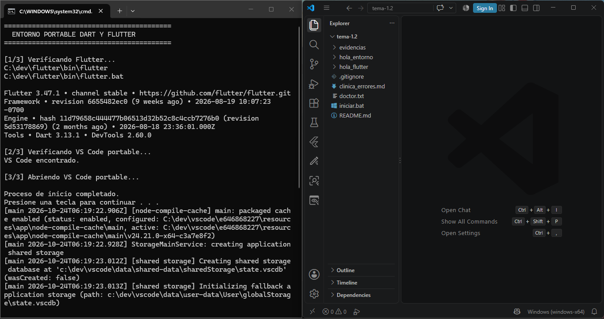<br>
  <em>Figura 9. <code>iniciar.bat</code>: <code>where flutter</code> lista <code>C:\dev\flutter\bin</code>, muestra la versión y abre VS Code portable</em>
</p>

<p align="center">
  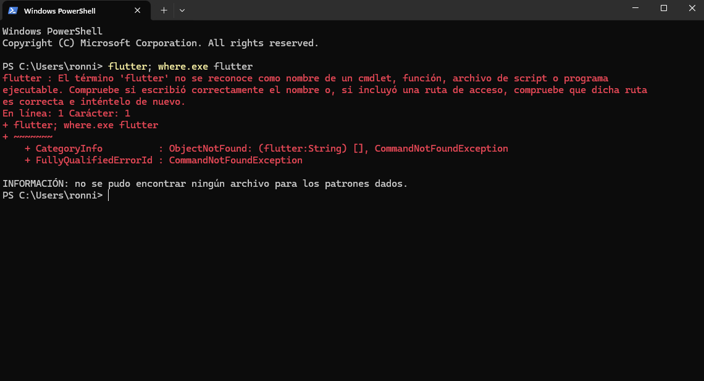<br>
  <em>Figura 10. Sin el script, <code>flutter</code> y <code>where.exe flutter</code> no se reconocen</em>
</p>

### Actividad 4 — Primeras ejecuciones en destinos ligeros

<p align="center">
  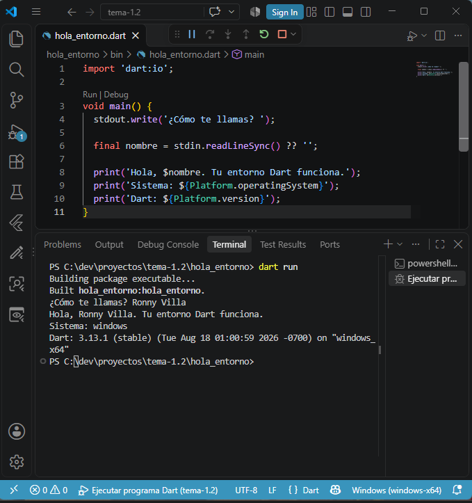<br>
  <em>Figura 11. <code>dart run</code>: pide el nombre, saluda y muestra el sistema y la versión de Dart</em>
</p>

<p align="center">
  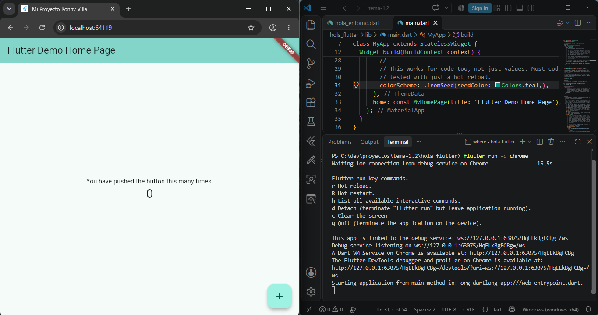<br>
  <em>Figura 12. Aplicación Flutter en Chrome con mi nombre en el título de la pestaña</em>
</p>

<p align="center">
  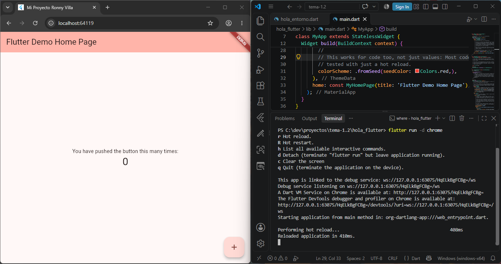<br>
  <em>Figura 13. Cambio de <code>seedColor</code> y hot reload con <code>r</code> (<code>Reloaded application</code>)</em>
</p>

## 12. Estructura del repositorio

```text
tema-1.2/
├── README.md
├── iniciar.bat
├── doctor.txt
├── clinica_errores.md
├── evidencias/        capturas de pantalla (13 archivos)
├── hola_entorno/      proyecto de consola (con .vscode/launch.json)
└── hola_flutter/      proyecto Flutter
```

## Conclusión

Se configuró un entorno portable de Dart y Flutter en `C:\dev`, con SDK, VS Code y caché de paquetes dentro de la misma carpeta. Se verificó con `flutter doctor`, se ejecutó Dart en consola con entrada de datos y Flutter en Chrome con hot reload, y se creó un kit de inicio (`iniciar.bat`) cuyo cambio de PATH es temporal. Las advertencias del diagnóstico (licencias de Android y componentes C++) no afectan los destinos ligeros usados en el curso.
